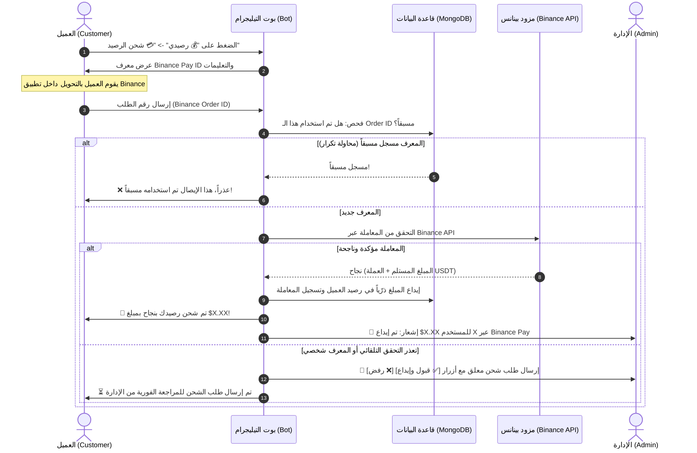
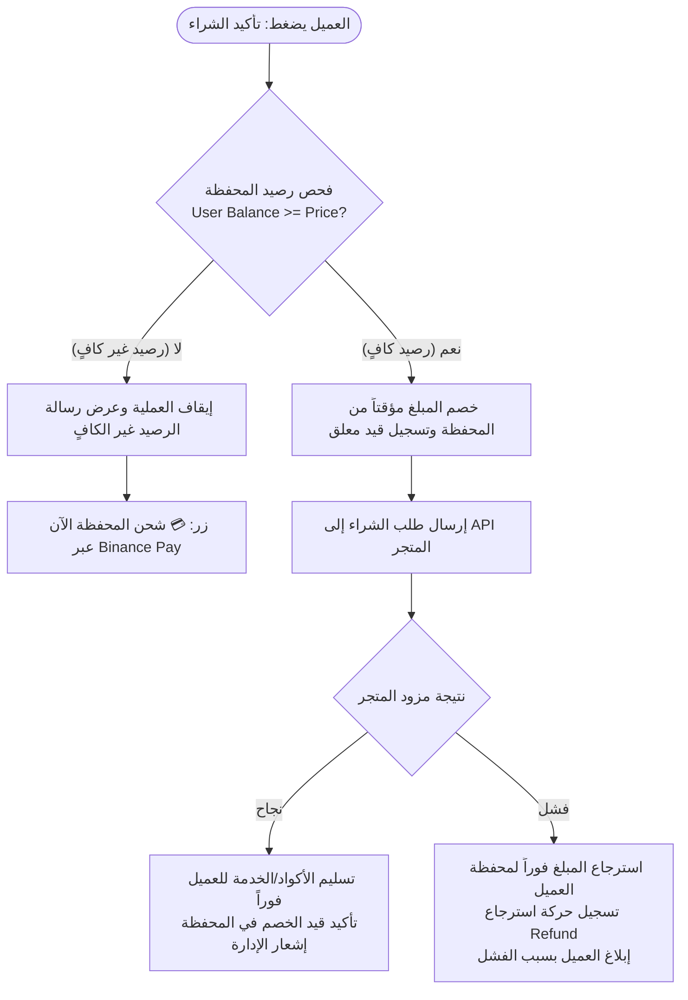

# 📑 خطة العمل الشاملة: نظام محفظة الزبائن والشحن التلقائي عبر Binance Pay

> **تاريخ الإعداد:** 11 أكتوبر 2026  
> **حالة الوثيقة:** مسودة جاهزة للتنفيذ (Implementation Blueprint)  
> **الهدف:** إضافة نظام محفظة مالية رقمية متكاملة لعملاء البوت مع التحقق الإلزامي من الرصيد قبل الشراء، وتوفير شحن الرصيد التلقائي عبر **Binance Pay**.

---

## 🎯 1. أهداف ومواصفات النظام

1. **نظام المحفظة (Customer Wallet):**
   * تخصيص رصيد رقمي لكل مستخدم في قاعدة بيانات MongoDB بالدولار ($ USDT).
   * إتاحة استعراض الرصيد، سجل الشحن، وسجل المشتريات من زر **💰 رصيدي**.
   * فرض التحقق من الرصيد قبل إتمام أي عملية شراء في **المتجر 1** أو **المتجر 2**:
     * إذا كان `رصيد العميل >= سعر المنتج`: تتم عملية الشراء ويُخصم المبلغ تلقائياً من محفظته مع تسجيل العملية.
     * إذا كان `رصيد العميل < سعر المنتج`: يتم رفض الطلب فوراً مع عرض المبلغ الناقص وزر سريع **💳 شحن الرصيد**.
     * في حال فشل المزود الخارجي أثناء الشراء: يتم استرجاع المبلغ فوراً لمحفظة العميل (Refund) مع إشعار بالعملية.

2. **طريقة الإيداع الأولى (Binance Pay Deposit):**
   * يضغط العميل على **💳 شحن الرصيد** ويختار **Binance Pay**.
   * يعرض البوت للعميل:
     * معرف بينانس الخاص بك (**Binance Pay ID / Binance ID**).
     * الاسم المستعار للحساب على بينانس للتحقق (Nickname).
     * تعليمات مبسطة لكيفية التحويل من تطبيق Binance.
   * يقوم العميل بالتحويل من تطبيقه، ثم يُدخل **رقم الطلب / معرف المعاملة (Order ID / Transaction ID)** في البوت.
   * يقوم البوت بالتحقق من صحة المعاملة وإيداع المبلغ فوراً في محفظة العميل دون تدخل بشري، مع وجود مسار موافقة بديل للأدمن (Fallback) في الحالات الاستثنائية.

---

## 🏗️ 2. مخطط تدفق العمليات (Architecture & Workflows)

### 2.1 مسار الشحن والإيداع عبر Binance Pay



---

### 2.2 مسار الشراء والتحقق من الرصيد



---

## 🔌 3. آلية التحقق من تحويلات Binance Pay

هنالك أسلوبان معتمدان برمجياً للتحقق من طلبات Binance Pay:

### الخيار (أ): التحقق البرمجي التلقائي بالكامل (Binance Pay API)
تتيح منصة Binance طريقتين رسميتين لفحص المعاملات:
1. **عبر Binance Spot/Pay SAPI (`GET /sapi/v1/pay/transactions`):**
   * يتم استخراج **API Key** و **API Secret** من حسابك الشخصي أو التجاري على بينانس (مع تفعيل صلاحية القراءة Read-Only فقط لحماية الحساب).
   * عند إرسال العميل لـ `Order ID`، يقوم البوت باستعلام سجل المعاملات الواردة لحسابك عبر الـ API.
   * يتحقق البوت تلقائياً من:
     * تطابق رقم الطلب (`orderId`).
     * حالة التحويل (`status == "SUCCESS"`).
     * نوع العملة (`currency == "USDT"` أو العملة المحددة).
     * المستلم هو حسابك فعلياً.
     * لم يسبق استخدامه مسبقاً في قاعدة بيانات البوت.
   * **النتيجة:** إضافة الرصيد للعميل خلال ثانية واحدة بدون أي تدخل بشري!

2. **عبر Binance Pay Merchant API (`POST /binancepay/openapi/v2/order/query`):**
   * يتطلب حساب تاجر في Binance Pay Merchant.

---

### الخيار (ب): التحقق السريع شبه التلقائي (1-Click Admin Verification)
كإجراء أمان إضافي أو كبديل مرن (Fallback) في حال عدم رغبة المالك في ربط مفاتيح API الخاصة ببينانس:
1. يرسل العميل رقم التحويل (أو صورة إشعار التحويل).
2. يقوم البوت بالتحقق من عدم تكرار الـ ID في قاعدة البيانات.
3. يصل إشعار فوري للأدمن في تيليجرام:
   > 🔔 **طلب شحن رصيد جديد عبر Binance Pay:**  
   > 👤 **العميل:** `@username` (ID: `123456`)  
   > 🆔 **رقم الطلب (Order ID):** `2728348912`  
   > 💵 **المبلغ المطلوب:** `$10.00`  
   > [✅ تأكيد وشحن $10] &nbsp;&nbsp;&nbsp; [❌ رفض الطلب]
4. بمجرد ضغط الأدمن على **✅ تأكيد**، يُودع الرصيد فوراً في محفظة العميل وتصله رسالة تنبيه.

> **💡 التوصية:** سنقوم ببرمجة النظام **بنظام هجين (Hybrid)** بحيث يتحقق تلقائياً عبر API بينانس، وإذا واجه أي تأخير أو خطأ، يُحوّل الطلب تلقائياً لنظام الموافقة السريعة للأدمن بنقرة زر دون أي تعليق للعميل.

---

## 🗄️ 4. هيكل قاعدة البيانات (MongoDB Schemas)

### 4.1 مجموعة المعاملات المالية (`wallet_transactions`)
تخزين سجل العمليات المالية الكامل للمحفظة للتدقيق والمحاسبة:
```json
{
  "_id": "ObjectId(...)",
  "transaction_id": "TXN_20261011_89412",
  "user_id": 8673630192,
  "type": "deposit", // deposit, purchase_store1, purchase_store2, refund, admin_adjustment
  "payment_method": "binance_pay", // binance_pay, manual_admin, balance
  "amount": 10.00,
  "balance_before": 2.50,
  "balance_after": 12.50,
  "reference_id": "2728348912", // Binance Order ID or Shop Order ID
  "status": "completed", // pending, completed, failed, rejected
  "created_at": "2026-10-11T05:30:00Z",
  "meta": {
    "payer_binance_id": "...",
    "product_name": null,
    "admin_id": null
  }
}
```

### 4.2 مجموعة طلبات إيداع بينانس (`binance_deposits`)
مخصصة لمنع التكرار (Unique Index) وتتبع حالة كل إيصال:
```json
{
  "_id": "ObjectId(...)",
  "binance_order_id": "2728348912", // مع فهرس فريد UNIQUE INDEX لمنع التكرار نهائياً
  "user_id": 8673630192,
  "amount": 10.00,
  "currency": "USDT",
  "status": "credited", // pending, credited, rejected
  "verified_via": "binance_api", // binance_api or admin_manual
  "claimed_at": "2026-10-11T05:30:00Z"
}
```

### 4.3 تحديث إعدادات النظام (`settings`)
تخزين بيانات حساب بينانس في MongoDB لتعديلها بأي وقت عبر لوحة الإدارة:
```json
{
  "key": "binance_pay_config",
  "pay_id": "87654321",
  "binance_id": "12345678",
  "nickname": "AneesStore",
  "min_deposit": 1.00,
  "auto_verify_enabled": true
}
```

---

## 🛡️ 5. إجراءات الحماية ومكافحة الاحتيال (Anti-Fraud & Security)

1. **منع هجمات إعادة الاستخدام (Replay Attacks / Duplicate Claims):**
   * إنشاء فهرس فريد `Unique Index` على حقل `binance_order_id` في MongoDB.
   * أي محاولة لإعادة إرسال نفس رقم الطلب ستُرفض فوراً على مستوى قاعدة البيانات مع رسالة تنبيه.
2. **العمليات الذرّية (Atomic Transactions):**
   * تحديث الأرصدة باستخدام `$inc` في MongoDB مع التحقق المزدوج لتفادي أي `Race Conditions` عند النقر السريع.
3. **حماية من التخمين والسبام (Rate Limiting):**
   * وضع حد أقصى (3 محاولات إدخال خاطئة خلال 15 دقيقة) لمنع محاولات تخمين أرقام الطلبات عشوائياً.
4. **مطابقة المبلغ والعملة:**
   * التأكد من أن المبلغ المودع في بينانس يطابق العملة المدعومة (USDT)، ولا يتم اعتماد المبالغ التجريبية الأقل من الحد الأدنى.

---

## 📋 6. خطوات التنفيذ المرحلية (Step-by-Step Implementation Tasks)

### المرحلة 1: إعداد المتغيرات والملفات المساعدة
- [ ] إضافة إعدادات بينانس في ملف `config.py`:
  - `BINANCE_PAY_ID`: معرف Binance Pay الخاص بالمتجر.
  - `BINANCE_API_KEY` و `BINANCE_API_SECRET` (للتحقق التلقائي).
  - `MIN_DEPOSIT_AMOUNT`: الحد الأدنى للإيداع (مثلاً $1.00).
- [ ] تفعيل خيار `REQUIRE_USER_BALANCE = True` افتراضياً ليصبح التحقق إلزامياً قبل أي عملية بيع.

### المرحلة 2: تحديث وحدة قاعدة البيانات (`database.py`)
- [ ] إنشاء دوال حركة المحفظة:
  - `record_wallet_transaction(...)`: تسجيل حركة مالية مع رصيد ما قبل وبعد.
  - `claim_binance_order_id(order_id, user_id, amount)`: حجز رقم طلب بينانس مع التحقق من عدم تكراره.
  - `get_user_wallet_history(user_id, limit=10)`: جلب كشف حساب العميل لآخر العمليات.
  - `get_binance_pay_settings()` و `set_binance_pay_settings(...)`.

### المرحلة 3: بناء محرك التحقق من بينانس (`binance_pay.py`)
- [ ] إنشاء فئة `BinancePayClient`:
  - دالة التوقيع والتشفير `HMAC-SHA256` لطلبات Binance SAPI.
  - استدعاء `GET /sapi/v1/pay/transactions` للبحث عن المعاملة برقم `orderId`.
  - دالة التحقق الشاملة `verify_transaction(order_id) -> dict`.

### المرحلة 4: واجهة المستخدم وتجربة الإيداع في البوت (`bot.py`)
- [ ] تحديث رسالة وقائمة `💰 رصيدي`:
  - إضافة زر `💳 شحن الرصيد (إيداع)`.
  - إضافة زر `📜 سجل المعاملات`.
- [ ] إنشاء مسار الشحن (Conversation Flow):
  1. اختيار طريقة الشحن -> **Binance Pay**.
  2. عرض بطاقة التحويل الجذابة (Pay ID + QR Code اختياري + الاسم المستعار).
  3. طلب إرسال `Order ID`.
  4. استلام الـ ID والتحقق منه فوراً.
  5. إيداع الرصيد وإرسال إشعار فوري للمستخدم والأدمن.
- [ ] إضافة لوحة أزرار الموافقة اليدوية للأدمن كخيار إضافي للمرونة.

### المرحلة 5: تأمين مسار الشراء (Store 1 & Store 2)
- [ ] التأكد من أن كلتا الدالتين `execute_purchase` و `execute_elite_purchase`:
  - تتحققان من كفاية الرصيد قبل مخاطبة المزود.
  - تخصمان الرصيد وتوثقان عملية الخصم في `wallet_transactions`.
  - في حال حدوث أي خطأ من المزود (مثل نفاد المخزون)، يتم استرجاع المبلغ فوراً وتوثيق عملية `refund`.

### المرحلة 6: لوحة تحكم الأدمن والاختبارات
- [ ] إضافة أوامر إدارة جديدة:
  - `/set_binance_id <ID>`: لتغيير الـ Pay ID من التيليجرام مباشرة دون لمس الكود.
  - `/wallet_tx <ID>`: لعرض كشف حساب لأي مستخدم.
- [ ] إضافة اختبارات شاملة في `test_bot.py` للتحقق من:
  - رفض الشراء عند عدم كفاية الرصيد.
  - نجاح الإيداع ومنع تكرار نفس رقم إيصال بينانس.
  - صحة عمليات الخصم والاسترجاع الذرّية.
- [ ] النشر والتأكيد على Railway عبر الـ CI/CD.

---

## 🚀 7. المتطلبات المطلوبة من مالك المتجر للبدء

للبدء في تنفيذ هذه الخطة بنجاح، نحتاج منك فقط توفير التالي (أو وضعها في ملف `.env`):
1. **معرفك في بينانس:**
   * **Binance Pay ID** (رقم مكون من 8-9 أرقام تجده في تطبيق بينانس -> Pay -> معرف الدفع / Pay ID).
   * **الاسم المستعار (Nickname)** المرتبط بالحساب للتأكد منه للمشترين.
2. **(اختياري للتحقق الآلي بالكامل):**
   * مفاتيح **API Key** و **API Secret** من منصة بينانس مع تفعيل صلاحية **قراءة المعاملات (Read-Only)** فقط (بدون أي صلاحيات سحب أو تداول لضمان أمان حسابك التام).
   * *ملاحظة:* إذا لم تكن ترغب في تفعيل API بينانس الآن، سيعمل النظام بنظام الموافقة الفورية بنقرة زر واحدة للأدمن (`1-Click Admin Approval`) بكل سلاسة وأمان!
